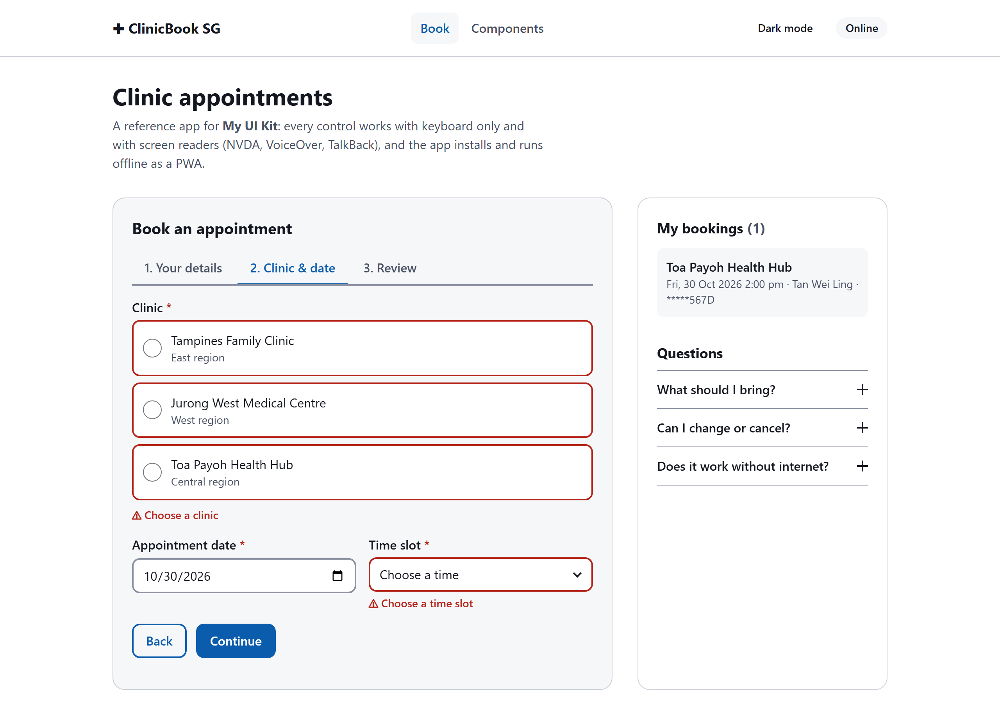
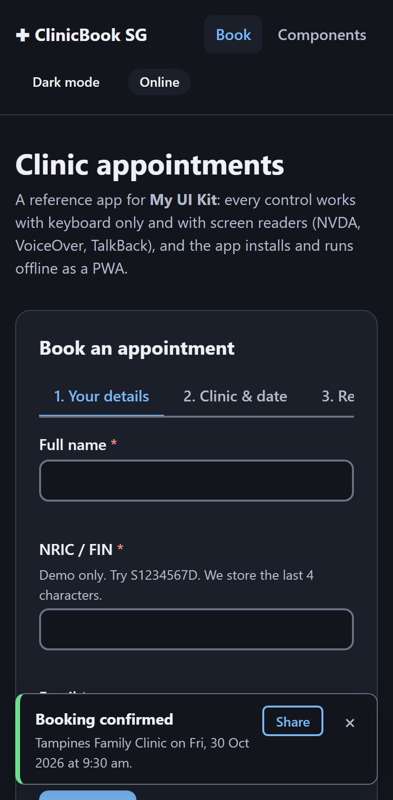
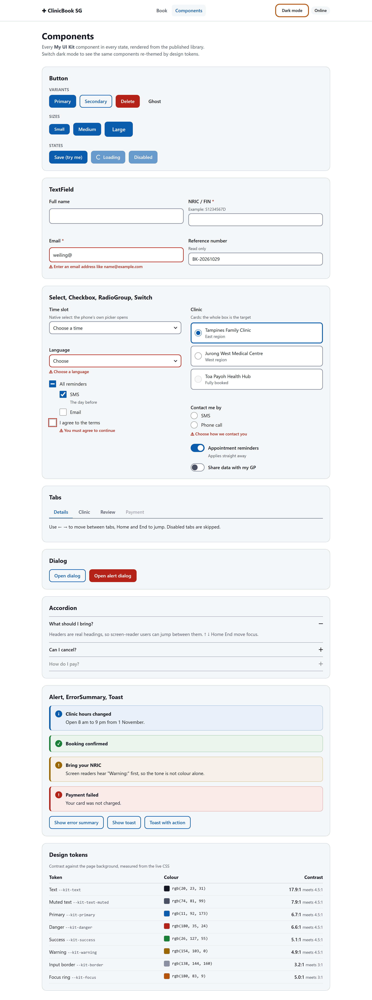
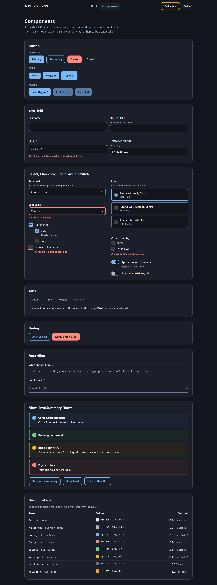

# My UI Kit

Accessible, composable React components (WCAG 2.2 AA, light and dark), published as an npm package with design tokens and pluggable Adobe Analytics. Alongside it is **ClinicBook SG**, a reference app that ships as a website, an installable offline PWA, and an Android app (Capacitor) from one codebase.

[](https://github.com/nisakhantalib/my-ui-kit/actions/workflows/ci.yml)
**Live:** [reference app](https://nisakhantalib.github.io/my-ui-kit/) · [Storybook](https://nisakhantalib.github.io/my-ui-kit/storybook/) · [npm](https://www.npmjs.com/package/@nisakhantalib/my-ui-kit)

| Booking flow, desktop (light) | Phone (dark), after booking |
|---|---|
|  |  |

| Component gallery (light) | Component gallery (dark) |
|---|---|
|  |  |

## What's in the repo

```
packages/ui          @nisakhantalib/my-ui-kit: 15 components, tokens, analytics adapters, Storybook
  tokens/tokens.json   design tokens (W3C format), the single source for CSS + TS + Figma
apps/demo            ClinicBook SG: Vite + Tailwind PWA, Capacitor Android shell, Playwright e2e
docs/
  specs/               business brief → user stories → acceptance criteria → tests; component specs
  adr/                 8 architecture decision records
  design/              principles, visual language, wireframes
```

## How this covers the role

| Requirement | Evidence |
|---|---|
| **Reusable, composable components across platforms** | 15 components; compound APIs (`Tabs`, `RadioGroup`, `Accordion`), one controlled/uncontrolled contract (`useControllableState`), forwarded refs. The same components run on web, PWA and Android ([ADR 0008](docs/adr/0008-hybrid-native-with-capacitor.md)); tokens ship as CSS, TS and JSON ([ADR 0005](docs/adr/0005-design-tokens-single-source.md)) |
| **Requirements → functional and development specs** | [Booking spec](docs/specs/booking-flow.md): stakeholder brief, resolved questions, user stories with Given/When/Then criteria, **each mapped to the e2e test that proves it**, and a tracking plan. [Component spec template](docs/specs/component-spec-template.md) + [RadioGroup spec](docs/specs/components/radio-group.md). Issue template for component requests |
| **Standards, best practices, architecture** | [CONTRIBUTING.md](CONTRIBUTING.md) (API conventions, definition of done, semver policy), [8 ADRs](docs/adr/), enforced by ESLint (typescript-eslint, react-hooks, **jsx-a11y strict**), Prettier, coverage floors and bundle budgets in CI |
| **Communication with business, product, design** | Storybook with usage guidance ("which message component?"), tokens page, theme toolbar; spec written for non-developers; PR template with screenshots and an a11y checklist |
| **Web fundamentals, HTML, CSS** | Native elements first ([ADR 0004](docs/adr/0004-native-elements-first.md)), CSS cascade layers, custom properties, `:has()`, `color-mix()`, `accent-color`, safe-area insets, forced-colours and reduced-motion support, 320px reflow |
| **JavaScript / TypeScript** | Strict TS (`noUncheckedIndexedAccess`), TypeScript 7 native compiler for types, generic hooks, types verified by Are the Types Wrong |
| **UI testing** | 4 layers ([ADR 0006](docs/adr/0006-testing-strategy.md)): **52** jsdom tests, **8** real-Chromium tests (contrast, focus-ring ratio, target size), **24 stories × 2 themes** axe audit, **9 × 2** Playwright journeys (desktop + Pixel 7). New checks are proven to fail on a broken build first |
| **React** | React 19, hooks, context, portals, compound components; `'use client'` output for Next.js Server Components |
| **npm package publishing** | ESM-only per-module build (Button alone: **~0.4 kB**), `exports` map, peer deps, publint + attw, size-limit, **Changesets**, **npm trusted publishing (OIDC) with provenance** ([ADR 0002](docs/adr/0002-esm-only-per-module-output.md)) |
| **Native / PWA / hybrid** | Workbox PWA (offline reload tested), **Capacitor 8 Android project** built to an APK in CI, native share sheet through `@capacitor/share` with Web Share and clipboard fallbacks |
| **Accessible UI for screen readers** | WAI-ARIA APG patterns, live regions that exist before content, focus management, `inert` behind dialogs, spoken alert tones. [ACCESSIBILITY.md](ACCESSIBILITY.md): WCAG criterion per component and a manual NVDA/VoiceOver/TalkBack script |
| **Visual design** | [Design principles and visual language](docs/design/README.md); measured contrast table in the gallery; screenshots above |
| *UI design, wireframes, mockups* | [Low-fi wireframes](docs/design/README.md#wireframes) (phone + desktop, annotated), mapped decision by decision to the build |
| *Build tools* | Vite 8 (Rolldown) library + app, tsc, Storybook (Vite builder), a small in-repo token generator |
| *CSS libraries* | Tailwind CSS 4 in the app, mapped onto the kit's tokens, with a layer order that keeps utilities able to override components ([ADR 0003](docs/adr/0003-css-custom-properties-and-cascade-layers.md)) |
| *Adobe Analytics / Omniture* | Adapters for **AppMeasurement** (`s.t()` / `s.tl()`), **AEP Web SDK** (`alloy`) and the **Adobe Client Data Layer**; consent-gated ([ADR 0007](docs/adr/0007-vendor-neutral-analytics.md)) |
| *CI/CD* | GitHub Actions: lint → format → tokens → types → tests + coverage → build → package checks → size → Storybook audit → e2e; Android APK job; Pages deploy; Changesets release; Dependabot |
| *Open source* | MIT, CONTRIBUTING, Code of Conduct, SECURITY policy, issue/PR templates, CODEOWNERS |

## Quick start

```bash
npm install
npx playwright install chromium   # once, for browser and e2e tests
npm run dev                       # builds the library, starts the app at http://localhost:5173
npm run storybook                 # http://localhost:6006
npm run ci                        # lint, format, types, tests, builds, package and size checks
npm run test:e2e                  # Playwright, desktop + Pixel 7
```

Android: `npm run android:apk -w demo` (needs JDK 21 and the Android SDK; CI builds it on every push).

## Using the package

```bash
npm install @nisakhantalib/my-ui-kit
```

```tsx
import { AnalyticsProvider, Button, RadioGroup, Radio, TextField, ToastProvider, adobeAnalyticsAdapter } from '@nisakhantalib/my-ui-kit';
import '@nisakhantalib/my-ui-kit/styles.css';

const adobe = adobeAnalyticsAdapter({
  variableMap: { component: 'eVar5', id: 'prop3' },
  eventMap: { form_submit: 'event12' },
});

<AnalyticsProvider adapters={[adobe]} enabled={userConsented}>
  <ToastProvider>
    <TextField label="Email" hint="We send the receipt here" error={emailError} required />
    <RadioGroup legend="Clinic" name="clinic" variant="cards" value={clinic} onValueChange={setClinic}>
      <Radio value="tampines" label="Tampines Family Clinic" description="East region" />
    </RadioGroup>
    <Button trackId="submit-claim">Submit</Button>
  </ToastProvider>
</AnalyticsProvider>;
```

Clicking the button sets `s.eVar5 = 'Button'`, `s.prop3 = 'submit-claim'`, `s.linkTrackVars = 'eVar5,prop3'` and calls `s.tl(true, 'o', 'button_click')`. On the Web SDK, swap in `adobeWebSdkAdapter` with the same config.

**With Tailwind**, declare the layer order once so preflight can't reset components but utilities still win:

```css
@layer theme, base, kit, components, utilities;
@import '@nisakhantalib/my-ui-kit/styles.css';
@import 'tailwindcss';
```

**Tokens in JS** (charts, native status bar, React Native): `import { tokens } from '@nisakhantalib/my-ui-kit'` → `tokens.color.primary.dark`. Raw JSON: `@nisakhantalib/my-ui-kit/tokens.json`.

## Components

| Group | Components |
|---|---|
| Actions | `Button` |
| Forms | `TextField`, `Select`, `Checkbox` (incl. mixed state), `RadioGroup` + `Radio` (plain / cards), `Switch` |
| Navigation | `Tabs` (`TabList`, `Tab`, `TabPanel`), `Accordion` + `AccordionItem`, `SkipLink` |
| Feedback | `Alert`, `ErrorSummary`, `ToastProvider` + `useToast`, `AnnouncerProvider` + `useAnnounce` |
| Overlays | `Dialog` (`dialog` / `alertdialog`) |
| Utilities | `VisuallyHidden`, `AnalyticsProvider` + `useTrack` / `usePageView`, `useControllableState`, `tokens`, `cx` |

Accessibility behaviour per component: [ACCESSIBILITY.md](ACCESSIBILITY.md). Props and live examples: Storybook.

## Release

1. In your PR, run `npm run changeset` and describe the change (patch / minor / major).
2. On merge to `main`, `release.yml` opens a **Version Packages** PR that bumps the version and writes `CHANGELOG.md`.
3. Merging that PR publishes to npm with **trusted publishing (OIDC)**: no `NPM_TOKEN` secret, provenance attached automatically.

One-time setup: publish the first version manually (`npm publish` from `packages/ui`), then on npmjs.com go to package → Settings → Trusted publishing → GitHub Actions, and enter repo `nisakhantalib/my-ui-kit` and workflow `release.yml`.

## License

[MIT](LICENSE)
