# My UI Kit

**An accessible, multi-brand, multi-market React component library for banking, governed like a product.** It has 24 components (including the hard banking ones), design tokens that refuse to build if contrast fails, Web Components for non-React teams, and lint, codemod and adoption tooling. It is proven by **Orchid Bank**, a fictional bank in five markets that runs as a website, an installable PWA and an Android app.

[](https://github.com/nisakhantalib/my-ui-kit/actions/workflows/ci.yml)

**Live:** [Orchid Bank](https://nisakhantalib.github.io/my-ui-kit/) · [Storybook](https://nisakhantalib.github.io/my-ui-kit/storybook/) · **Start here:** [one-page case study](docs/case-study.md)

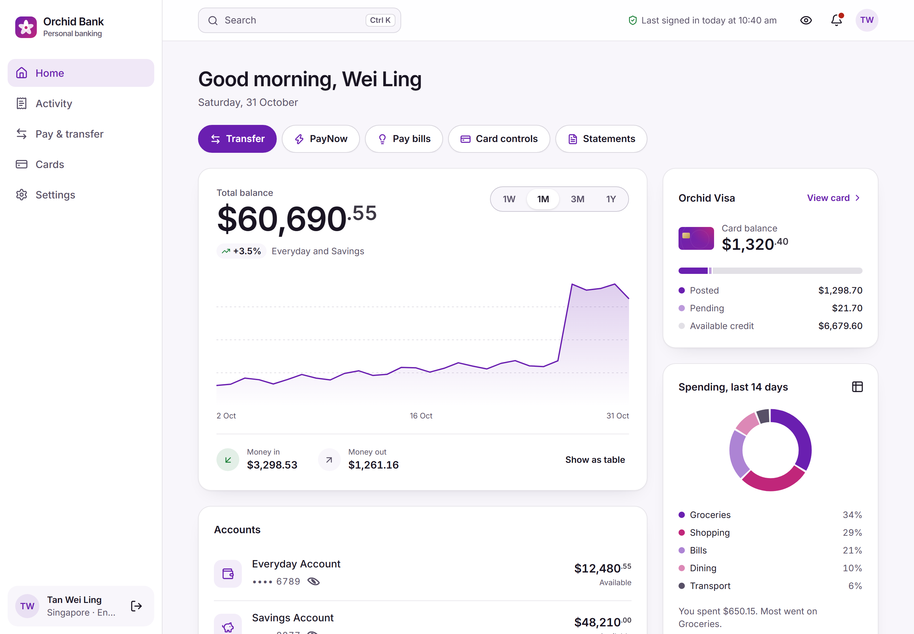

| Sign in: pick a market, one button in | Balance chart: hover, drag or arrow keys | Transaction details sheet |
|---|---|---|
| 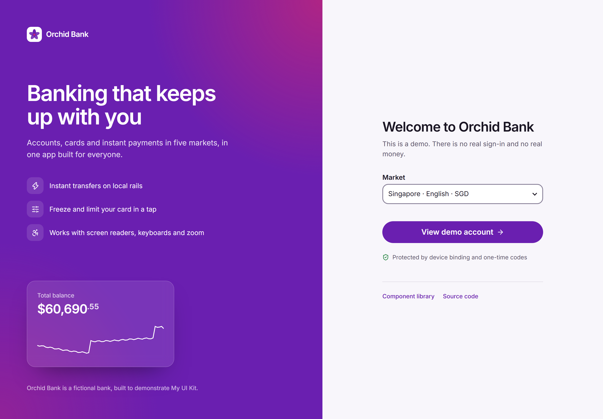 | 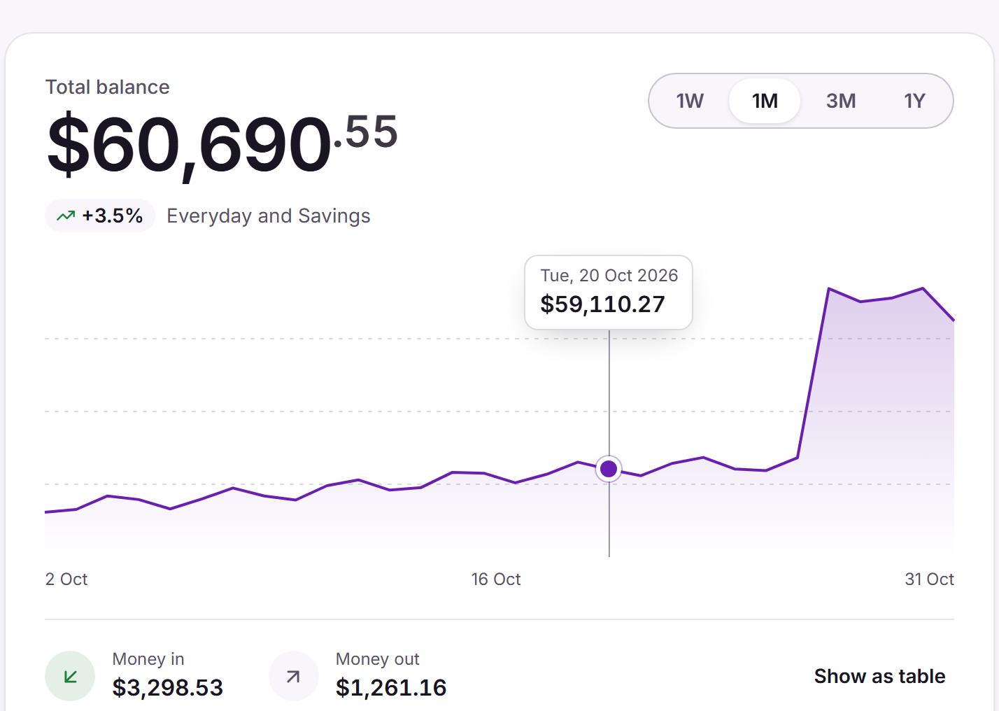 | 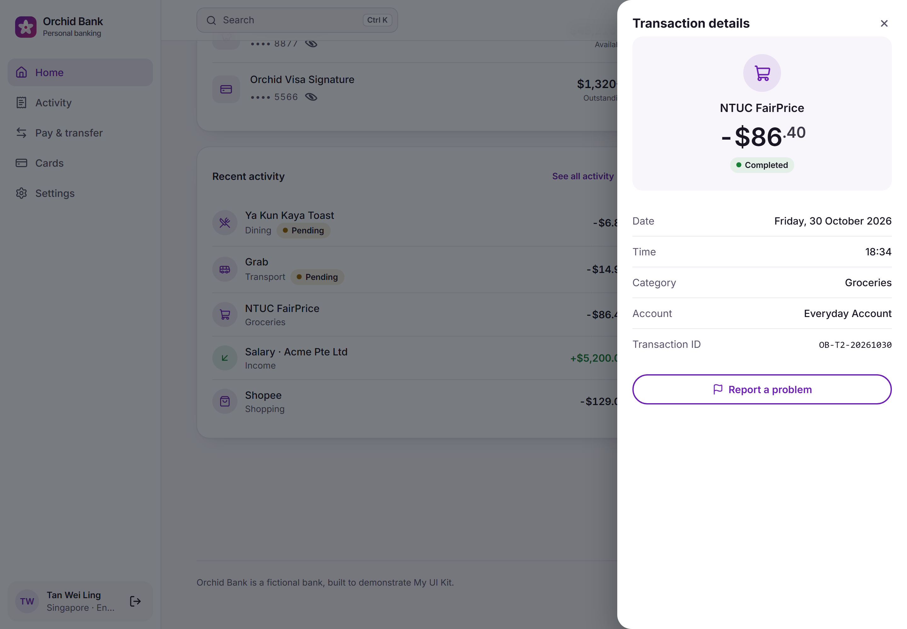 |

| Dark mode | Private client tier (same components, different tokens) |
|---|---|
| 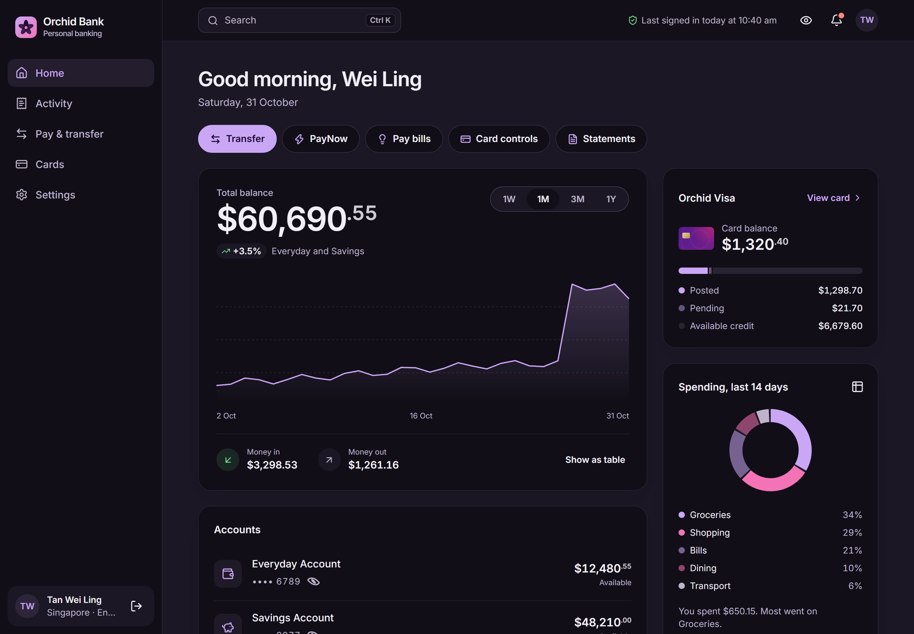 | 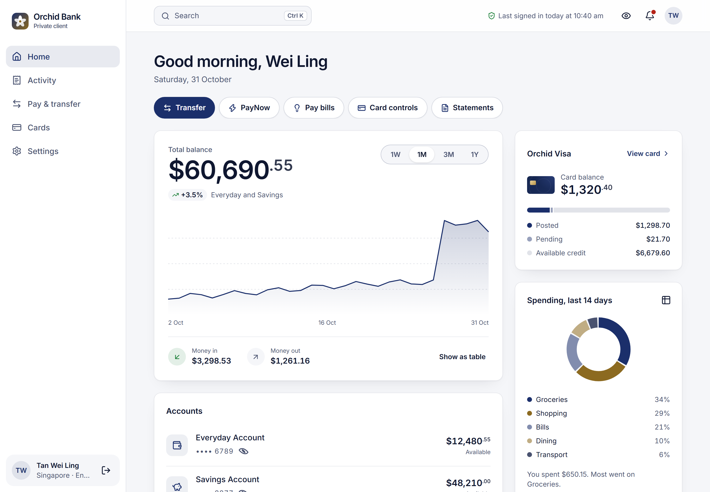 |

| Activity: search, filters, CSV | Cards: freeze, limits, report lost | One-time-code approval |
|---|---|---|
| 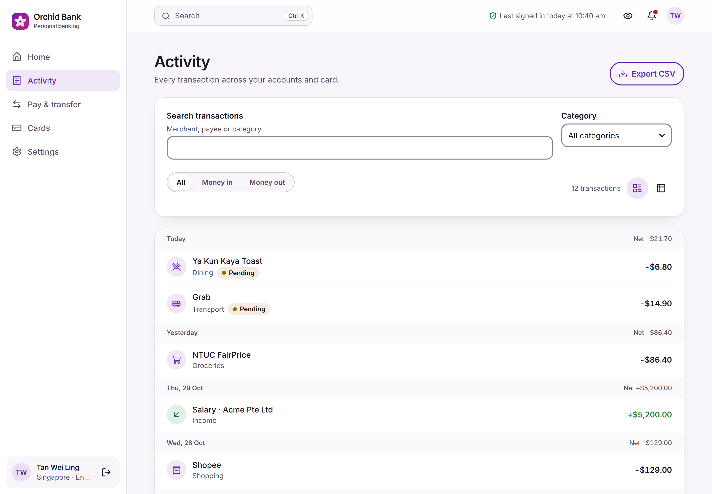 | 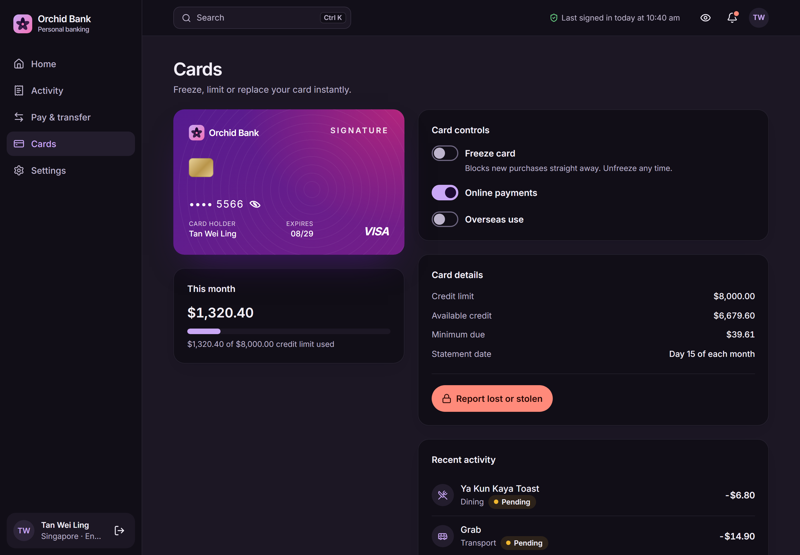 | 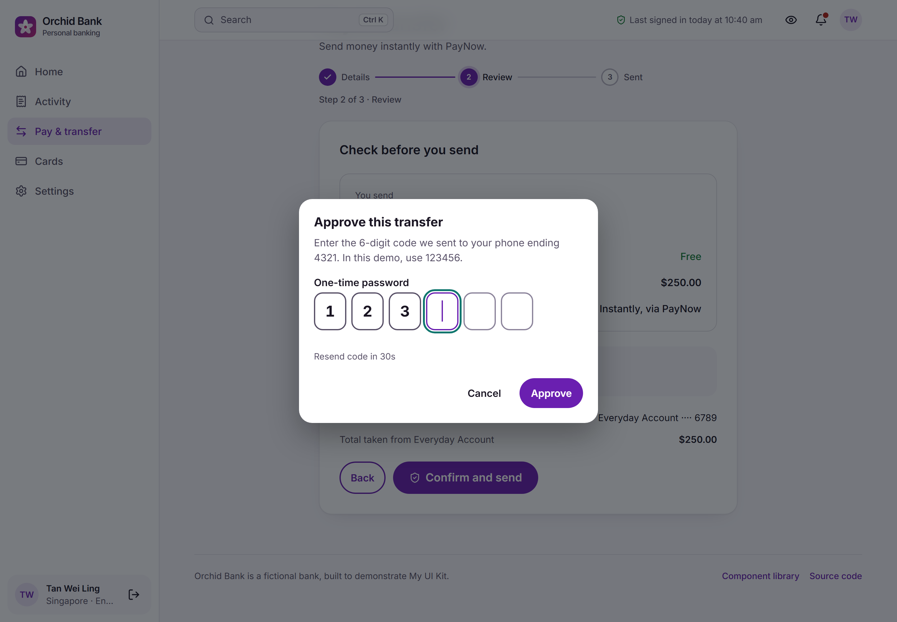 |

| Hong Kong · 繁體中文 (phone, dark) | Indonesia · Bahasa (phone receipt) |
|---|---|
| 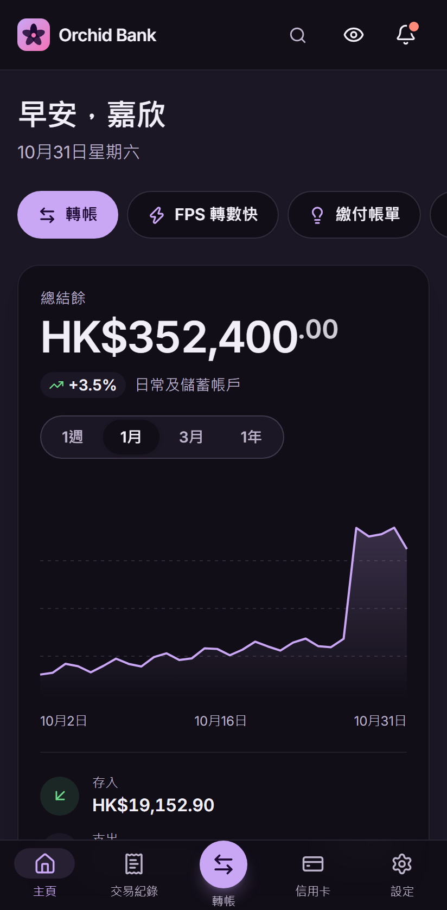 | 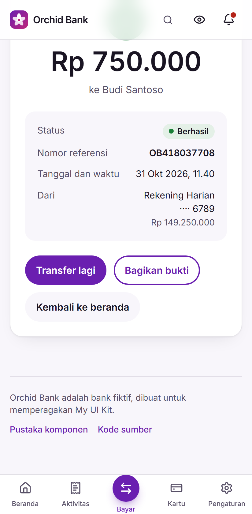 |

## What's in the repo

```
packages/
  ui              @nisakhantalib/my-ui-kit: 24 components, KitProvider (locale/currency/i18n), analytics adapters
    tokens/       palette → semantic → component tokens; brands civic, orchid, private; contrast.json
  elements        @nisakhantalib/my-ui-kit-elements: the same components as <kit-*> Web Components
  eslint-plugin   lint rules: no hard-coded colours, prefer kit components, no deprecated props (autofix)
  codemods        jscodeshift migrations, one for each deprecation
  scanner         kit-scan: adoption report across repos (usage, props, versions, deprecated usages, gaps)
apps/
  bank            Orchid Bank: Home, Activity, Pay & transfer, Cards, Settings; 5 markets; PWA + Android
docs/
  case-study.md   one page for reviewers
  specs/          brief → user stories → acceptance criteria → the test that proves each one
  adr/            9 architecture decision records
  governance.md   contribution model, RFCs, semver, deprecation policy, adoption metrics
  design/         research findings, principles, visual language, annotated wireframes
```

## How this covers the role

| Requirement | Evidence |
|---|---|
| **Reusable, composable components across platforms** | 24 components with compound APIs (`Tabs`, `RadioGroup`, `Accordion`) and one controlled/uncontrolled contract. Runs on **web, PWA, Android** (Capacitor) and **non-React stacks** (`<kit-*>` Web Components), in **3 brands × 5 markets × 3 languages** |
| **Business and design requirements → specs** | [Transfer spec](docs/specs/transfer-flow.md): stakeholder brief, resolved questions, Given/When/Then criteria **each mapped to its e2e test**, tracking plan. [Component spec template](docs/specs/component-spec-template.md) + [RadioGroup spec](docs/specs/components/radio-group.md) |
| **Standards, best practices, architecture** | [9 ADRs](docs/adr/), [CONTRIBUTING](CONTRIBUTING.md) (API conventions, definition of done), [governance model](docs/governance.md), **enforced** by ESLint (jsx-a11y strict + our own plugin), Prettier, coverage floors, size budgets, a token contrast gate, a deprecated-API gate |
| **Communication with business, product, design** | Storybook with usage guidance, brand/market/theme toolbars, a live contrast report and an adoption dashboard; specs written for non-developers; design research with sources ([design/](docs/design/README.md)) |
| **Web fundamentals, HTML, CSS** | Native elements first ([ADR 0004](docs/adr/0004-native-elements-first.md)); cascade layers, custom properties, `:has()`, `color-mix()`, safe-area insets, forced colours, reduced motion, 320px reflow on every page |
| **JavaScript / TypeScript** | Strict TS (`noUncheckedIndexedAccess`), generic components (`Combobox<T>`, `DataTable<T>`), TS 7 for types; exact minor-unit money arithmetic |
| **UI testing** | 87 jsdom + 8 real-Chromium component tests; **54 stories × 3 brands × 2 themes** axe audit; 6 Web Component browser tests; **19 Playwright scenarios × desktop + Pixel 7** (every page under axe and a strict CSP, journeys, offline); visual regression in a pinned container; Lighthouse CI; 49 tooling tests. Each new gate was first shown to fail on a deliberately broken build |
| **React** | React 19, hooks, context, portals, lazy routes, compound components, `'use client'` output for Next.js Server Components |
| **npm package publishing** | Per-module ESM (`Button` alone **365 B**), `exports` map, publint + attw, size-limit, **Changesets**, **trusted publishing (OIDC) with provenance**, **CycloneDX SBOM** per release; 5 publishable packages |
| **Native / PWA / hybrid** | Workbox PWA (installable, offline reload tested), Capacitor 8 Android APK built in CI, native share sheet with web fallbacks |
| **Accessible UI for screen readers** | APG patterns; live regions that exist before content; focus moves to each new page and step; single-input OTP; spoken currency; masked values read as "ending 6789"; WCAG 2.5.3 label-in-name enforced. [ACCESSIBILITY.md](ACCESSIBILITY.md) has the WCAG criterion per component and NVDA/VoiceOver/TalkBack scripts |
| **Visual design** | A research-led banking UI ([design/](docs/design/README.md)); three complete brands from one component set; dark mode designed (not inverted) with a dedicated `brand-surface` role |
| *UI design, wireframes, mockups* | [Annotated wireframes](docs/design/README.md#wireframes) for phone and desktop, mapped decision by decision to the build |
| *Build tools* | Vite 8 (Rolldown) library, app and Web Components builds, tsc, Storybook, an in-repo token compiler |
| *CSS libraries* | Tailwind 4 in the app, mapped onto kit tokens, with a layer order that keeps utilities able to override ([ADR 0003](docs/adr/0003-css-custom-properties-and-cascade-layers.md)) |
| *Adobe Analytics / Omniture* | Adapters for **AppMeasurement** (`s.t()` / `s.tl()`), **AEP Web SDK** (alloy) and the **Adobe Client Data Layer**, consent-gated; tracking plan in the transfer spec |
| *CI/CD* | GitHub Actions: lint → format → tokens → types → tests → builds → package checks → size → Storybook audit → e2e → Lighthouse → visual → Android APK → Pages; Changesets release with SBOM; Dependabot |
| *Open source* | MIT, CONTRIBUTING, Code of Conduct, security policy, issue/PR templates, CODEOWNERS |

## Quick start

```bash
npm install
npx playwright install chromium   # once, for browser and e2e tests
npm run dev                       # Orchid Bank at http://localhost:5174
npm run storybook                 # http://localhost:6006
npm run ci                        # lint, format, types, all unit/browser/tooling tests, builds, package and size checks
npm run test:e2e                  # Playwright, desktop + Pixel 7
```

Android: `npm run android:apk -w bank` (needs JDK 21 and the Android SDK; CI builds it on every push).

## Using the package

```bash
npm install @nisakhantalib/my-ui-kit
```

```tsx
import { AmountInput, Button, Combobox, KitProvider, ToastProvider } from '@nisakhantalib/my-ui-kit';
import '@nisakhantalib/my-ui-kit/styles.css';

// Brand and dark mode are HTML attributes: <html lang="zh-HK" data-brand="orchid" data-theme="dark">
<KitProvider locale="zh-HK" currency="HKD">              {/* formats, parses and translates the kit's own words */}
  <ToastProvider>
    <Combobox label="收款人" items={payees} getKey={(p) => p.id} getLabel={(p) => p.name} onValueChange={setPayee} />
    <AmountInput label="金額" value={cents} onValueChange={setCents} />   {/* integer minor units */}
    <Button trackId="transfer-continue">繼續</Button>                       {/* sends an analytics event */}
  </ToastProvider>
</KitProvider>
```

- **Brands:** `data-brand="civic" | "orchid" | "private"` on `<html>` or any element; `data-theme="dark"` or the OS setting for dark mode.
- **Tailwind:** declare `@layer theme, base, kit, components, utilities;` before importing both stylesheets.
- **Tokens in JS:** `import { tokens, brandTokens, contrastReport } from '@nisakhantalib/my-ui-kit'`; raw JSON at `@nisakhantalib/my-ui-kit/tokens/*`.
- **Analytics:** wrap in `<AnalyticsProvider adapters={[adobeWebSdkAdapter({ variableMap })]} enabled={consent}>`.
- **Not on React?** Use [`@nisakhantalib/my-ui-kit-elements`](packages/elements/README.md).

## Components

| Group | Components |
|---|---|
| Actions | `Button`, `IconButton` |
| Forms | `TextField`, `Select`, `Checkbox` (incl. mixed state), `RadioGroup` + `Radio` (plain / cards / segmented), `Switch` |
| Banking | `Money`, `AmountInput`, `OTPInput`, `Combobox`, `DataTable`, `MaskedValue`, `Badge` |
| Navigation | `Tabs` (`TabList`, `Tab`, `TabPanel`), `Accordion` + `AccordionItem`, `SkipLink` |
| Feedback | `Alert`, `ErrorSummary`, `ToastProvider` + `useToast`, `Skeleton`, `AnnouncerProvider` + `useAnnounce` |
| Overlays | `Dialog` (`dialog` / `alertdialog`; centred or side `sheet`) |
| Foundations | `KitProvider` + `useKit`, `AnalyticsProvider` + `useTrack` / `usePageView`, `VisuallyHidden`, `useControllableState`, `tokens` |

## Release

1. In your PR, run `npm run changeset` and describe the change (patch / minor / major; see the [deprecation policy](docs/governance.md#deprecation-policy)).
2. On merge to `main`, `release.yml` opens a **Version Packages** PR that bumps versions and writes the CHANGELOGs.
3. Merging that PR publishes to npm with **trusted publishing (OIDC)**: no `NPM_TOKEN`, provenance attached, SBOM uploaded to the GitHub release.

One-time setup: publish each package once by hand (`npm publish` in its folder). Then, on npmjs.com, go to package → Settings → Trusted publishing → GitHub Actions and enter repo `nisakhantalib/my-ui-kit` and workflow `release.yml`.

## License

[MIT](LICENSE). Orchid Bank is a fictional bank; any resemblance to a real institution is unintended.
