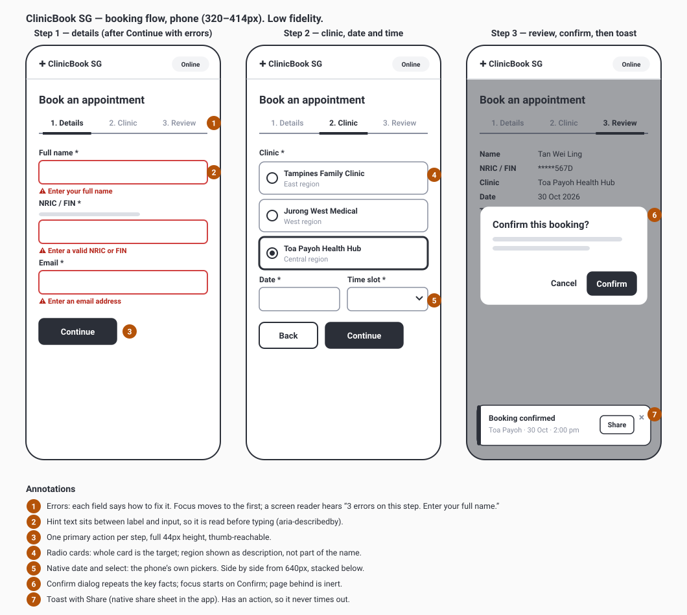
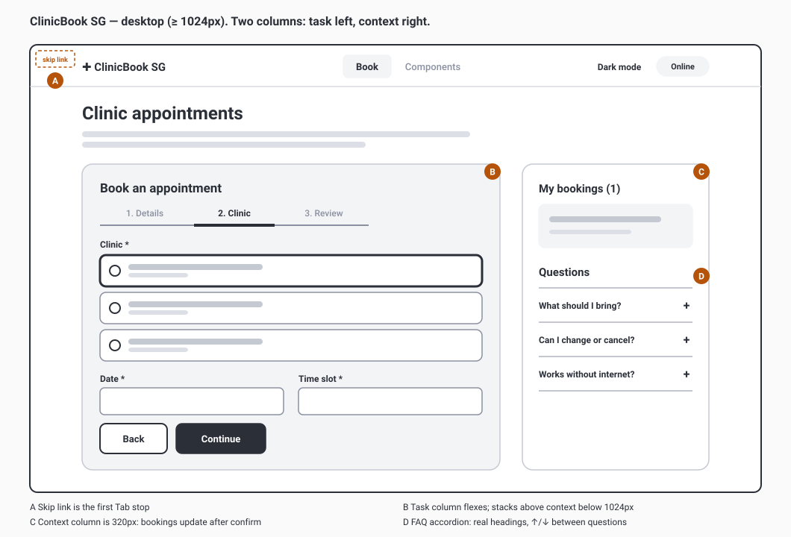

# Design

How ClinicBook SG and My UI Kit look and why. Low-fidelity wireframes came first; the high-fidelity result is the live component gallery (`#/components`) and Storybook.

## Design principles

1. **Calm and plain.** Public services are used under stress (unwell, in a queue, on a small phone). One task per screen, one primary button, no decoration that needs explaining.
2. **Obvious over clever.** Visible labels above every field, native pickers, words instead of icons alone.
3. **Mistakes are normal.** Every error says how to fix it, in place, and focus goes there.
4. **Same in every mode.** Light, dark, forced colours, 200% zoom and 320px are designed states, not afterthoughts.
5. **Tokens or it didn't happen.** Every colour and space comes from `tokens.json`, so design and code can't drift.

## Wireframes

Low fidelity, to agree flow and hierarchy with stakeholders before any visual design. Generated from `wireframes/generate.py` so they stay editable and diffable.

### Phone (designed first: about 80% of visits)

### Desktop

### From wireframe to build

| Wireframe decision | Implemented as |
|---|---|
| Steps as tabs, one primary action each | `Tabs activation="manual"` + `Button` |
| Errors under each field, focus to the first | `TextField error` + `useAnnounce` (assertive) |
| Clinic choice as large cards | `RadioGroup variant="cards"` |
| Native date and time pickers | `TextField type="date"` + `Select` |
| Confirm before committing | `Dialog` with `initialFocusRef` |
| Non-blocking success with Share | `useToast` with an action → `@capacitor/share` |
| FAQ next to the task | `Accordion type="single"` in the aside |

## Visual language

| Foundation | Values | Rationale |
|---|---|---|
| **Colour** | Blue `#0b5cad` primary, red `#b42318` danger, green `#1a7f37` success, amber `#9a6700` warning; dark theme lightens each | Every text pair ≥ 4.5:1 and every UI pair ≥ 3:1 in both themes, measured live on the Components page |
| **Focus** | 3px ring, 2px offset, `#b45309` (light) / `#f5a524` (dark) | Visible on every background (≥ 3:1, tested). A thick ring outside the control, unlike any border or state style, so focus is unmistakable |
| **Type** | System font stack; 16px body; 600 for labels, 700 for headings | Fastest to load, best hinting for each OS, familiar on each device |
| **Spacing** | 4 · 8 · 12 · 16 · 24 | A small scale people actually stick to |
| **Shape** | 10px radius; 15px for dialogs | Soft enough to feel approachable, square enough to look official |
| **Targets** | 44px controls, 24px minimum | WCAG 2.5.8 minimum is 24px; 44px matches iOS/Android guidance |
| **Motion** | 150–200ms ease-out, opacity + 8px translate | Explains where things came from; removed under `prefers-reduced-motion` |

## Layout

- Single column below 1024px; at 1024px and up, task column + 320px context column (`lg:grid-cols-[minmax(0,1fr)_320px]`).
- Content max width 1024px (`max-w-5xl`), 16px gutters.
- Nothing scrolls sideways at 320px (WCAG 1.4.10), which is tested in CI.
- Safe-area insets respected for installed PWA and native shell (toasts clear the home bar).

## Handoff with design tools

`packages/ui/tokens/tokens.json` uses the W3C Design Tokens format, which Tokens Studio for Figma imports directly. A designer changing a colour in Figma exports the JSON, a developer runs `npm run tokens`, and review sees both the value and its contrast note in one diff.

## Screenshots of the built UI

High-fidelity results, light and dark: see [docs/screenshots](../screenshots/) and the README.
